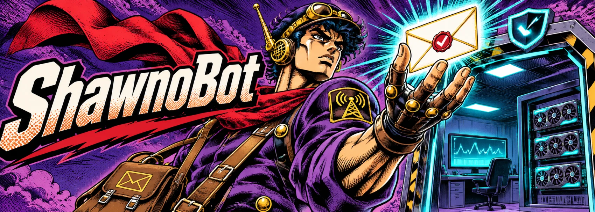
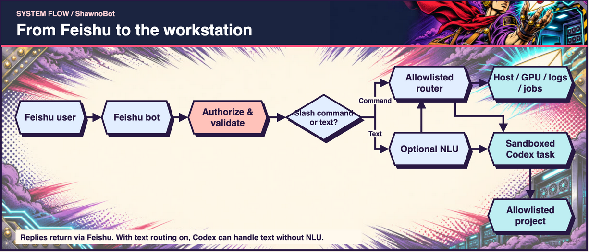
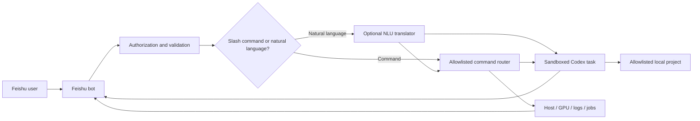

# ShawnoBot



[简体中文](README.zh-CN.md) · English

**A secure Feishu gateway for your local Codex workstation.**

ShawnoBot translates Feishu messages into allowlisted commands or verified Codex
tasks. It lets you check GPUs, training logs, project status, local jobs, and Codex
sessions while away from your computer—without exposing an unrestricted shell.

[Quick start](#quick-start-on-windows) · [How it works](#how-it-works) · [Commands](#commands) · [Security model](#security-model)

> ShawnoBot is an independent open-source project. It is not affiliated with or
> endorsed by OpenAI, Feishu, ByteDance, or DeepSeek.

## Highlights

- **Remote visibility** — host status, NVIDIA GPU usage, project logs, and tracked jobs.
- **Controlled execution** — only named tasks with fixed argument arrays are allowed.
- **Codex CLI workflows** — start, continue, inspect, and cancel sandboxed Codex work.
- **Codex desktop session access** — read or resume explicitly allowlisted sessions.
- **Natural-language routing** — an optional DeepSeek model translates messages into
  structured commands or internal Codex prompts; its answer is never returned directly.
- **Process notifications** — watch a PID and receive a Feishu message when it exits.
- **Deny-by-default security** — user, group, project, task, log, and session allowlists.

## How it works



[Editable source (draw.io)](assets/readme/workflow-en.drawio)

<details>
<summary>Expand the Mermaid diagram</summary>



</details>

DeepSeek, when enabled, is a translator—not the final assistant. ShawnoBot validates
its structured output, then either runs an existing safe command or passes the
translated task to Codex. Codex performs the actual project inspection or work and
returns the result.

## Requirements

- Python 3.10 or newer
- A Feishu custom app with bot capability
- Codex CLI for Codex features
- NVIDIA drivers and `nvidia-smi` for GPU reporting
- Optional: a DeepSeek API key for natural-language translation

## Quick start on Windows

```powershell
git clone https://github.com/Xiaoqian-Zhang-Shawno/ShawnoBot.git
cd ShawnoBot
py -m venv .venv
.\.venv\Scripts\python.exe -m pip install -e ".[dev]"
Copy-Item .env.example .env
Copy-Item config.example.yaml config.yaml
```

Edit the two local files:

- `.env`: Feishu credentials and the optional DeepSeek key.
- `config.yaml`: Feishu allowlists, projects, logs, tasks, and Codex permissions.

Both files are ignored by Git. Never place real credentials in
`config.example.yaml`, source code, screenshots, issues, or logs.

Validate and run:

```powershell
.\.venv\Scripts\python.exe -m shawnobot --config config.yaml check
.\.venv\Scripts\python.exe -m shawnobot --config config.yaml run
```

You can also run `.\scripts\run.ps1` after setup.

## Feishu setup

1. Create an app in the Feishu Open Platform and enable the bot capability.
2. Add the message permissions required by your tenant and publish an app version.
3. Configure event delivery for received messages using the SDK connection supported
   by this project.
4. Put the App ID and App Secret in `.env`.
5. Put your Feishu `open_id` in `feishu.allowed_user_ids`.
6. For group use, also add the group chat ID to `feishu.allowed_chat_ids`.

An empty user allowlist authorizes nobody. Group messages require both the sender and
the group to be allowlisted. Keep `require_mention_in_group: true` unless you have a
specific reason to change it.

## Safe configuration

The example configuration starts with Codex, natural-language routing, and remote
project registration disabled. Enable features gradually after verifying Feishu
authorization.

```yaml
codex:
  enabled: true
  executable: "codex"
  sandbox: "read-only"
  natural_language_enabled: true
  default_project: "demo"

projects:
  demo:
    path: "D:/projects/demo"
    codex_enabled: true
    logs:
      train: "logs/train.log"
    tasks:
      test:
        description: "Run tests"
        cwd: "."
        argv: ["python", "-m", "pytest", "-q"]
        background: false
        timeout_seconds: 300
```

Use `read-only` first. Switch an individual, version-controlled project to
`workspace-write` only when remote editing is intentional. Do not run an unattended
bot with unrestricted host access.

## Commands

| Area | Examples |
| --- | --- |
| Help and routing | `/help`, `/nlu-status` |
| Projects | `/projects`, `/project-new`, `/project-allow` |
| Machine and training | `/host`, `/gpu`, `/status`, `/log` |
| Controlled tasks | `/task`, `/jobs`, `/joblog`, `/stop` |
| Codex CLI | `/codex`, `/codex-status`, `/codex-cancel`, `/new`, `/context` |
| Usage | `/usage` |
| Sessions and desktop | `/sessions`, `/session-new`, `/session`, `/desktop`, `/desktop-projects`, `/desktop-send` |
| Notifications | `/watch`, `/watches`, `/unwatch` |

Send `/help` in Feishu for exact syntax. Ordinary text becomes a continuous Codex
conversation when `natural_language_enabled` is on. If NLU is enabled, it first
translates the intent; slash commands always bypass NLU.

Desktop sessions are discovered from local Codex state, but only configured session
IDs can be read or resumed. Avoid sending to the same session from Feishu and the
desktop app at the same time.

## Security model

ShawnoBot is a remote execution gateway and should be treated as security-sensitive:

- no arbitrary shell endpoint;
- subprocesses use argument arrays with `shell=False`;
- project files and logs are resolved below configured project roots;
- task stopping is limited to jobs launched and tracked by ShawnoBot;
- Codex always receives an explicit sandbox and timeout;
- NLU output is untrusted, schema-validated, and command-allowlisted;
- secrets stay in environment variables;
- actions are recorded in a local JSONL audit log.

Run the bot under a dedicated non-administrator account when possible. Review
[SECURITY.md](SECURITY.md) before enabling write access or remote registration.

## Development

```powershell
.\.venv\Scripts\python.exe -m pytest
.\.venv\Scripts\python.exe -m ruff check .
```

Contributions are welcome. Please preserve deny-by-default authorization and add
tests for changes involving commands, paths, sessions, or subprocesses.

## Support the project

If ShawnoBot saves you time, you can support continued development through Alipay.
The QR image is intentionally included in this public repository.


## License

[MIT](LICENSE)
