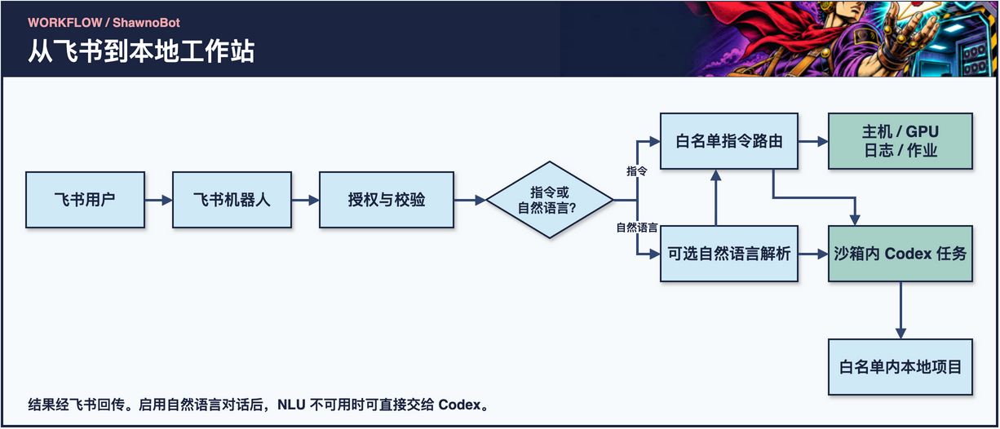
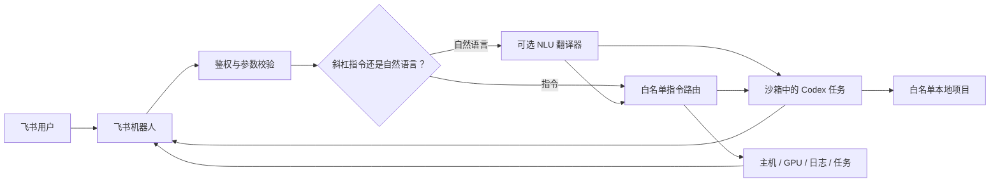

# ShawnoBot


简体中文 · [English](README.md)

**把飞书变成你本地 Codex 工作站的安全遥控台。**

ShawnoBot 将飞书消息转换为白名单指令或经过验证的 Codex 任务。离开电脑后，
你仍可查看 GPU、训练日志、项目状态和本地任务，并继续 Codex 会话，同时避免
暴露一个不受限制的远程 Shell。

[快速开始](#windows-快速开始) · [工作原理](#工作原理) · [指令概览](#指令概览) · [安全模型](#安全模型) · [故障排查](#故障排查)

> ShawnoBot 是独立开源项目，与 OpenAI、飞书、字节跳动及 DeepSeek 无隶属或
> 官方背书关系。

## 主要能力

- **远程查看**：主机状态、NVIDIA GPU 占用、项目日志和后台任务。
- **受控执行**：只运行配置中预先命名、参数固定的任务。
- **Codex CLI 工作流**：在明确沙箱中发起、续写、查看或取消 Codex 任务。
- **Codex 桌面会话访问**：读取或续写明确列入白名单的桌面端会话。
- **自然语言路由**：可选 DeepSeek 模型只负责把意图翻译成结构化指令或
  Codex 内部任务，其回复不会直接展示给飞书用户。
- **进程完成提醒**：跟踪 PID，进程结束后由机器人主动通知。
- **默认拒绝**：用户、群聊、项目、任务、日志和会话均采用白名单。

## 环境要求

- Python 3.10 或更高版本
- 已启用机器人能力的飞书自建应用
- 使用 Codex 功能时需要 Codex CLI
- GPU 查询需要 NVIDIA 驱动和 `nvidia-smi`
- 可选：用于自然语言翻译的 DeepSeek API Key

## Windows 快速开始

```powershell
git clone https://github.com/Xiaoqian-Zhang-Shawno/ShawnoBot.git
cd ShawnoBot
py -m venv .venv
.\.venv\Scripts\python.exe -m pip install -e ".[dev]"
Copy-Item .env.example .env
Copy-Item config.example.yaml config.yaml
```

随后只需修改两个本地文件：

- `.env`：飞书凭证和可选的 DeepSeek 密钥。
- `config.yaml`：飞书白名单、项目、日志、任务和 Codex 权限。

这两个文件均已被 Git 忽略。不要把真实密钥写入示例配置、源代码、截图、
Issue 或日志。

检查配置并启动：

```powershell
.\.venv\Scripts\python.exe -m shawnobot --config config.yaml check
.\.venv\Scripts\python.exe -m shawnobot --config config.yaml run
```

完成初始化后，也可以直接运行 `.\scripts\run.ps1`。


## 工作原理

[](assets/readme/workflow-zh.webp)

[可编辑源图（draw.io）](assets/readme/workflow-zh.drawio)

<details>
<summary>展开 Mermaid 流程图</summary>



</details>

启用 DeepSeek 后，它只充当“翻译官”，不是最终回答者。ShawnoBot 会校验模型
输出，再选择已有安全指令，或把翻译后的任务交给 Codex。真正的项目检查、代码
操作和结果整理仍由 Codex 完成。

## 从查看状态到受控执行

| 我想做什么 | 从这里开始 | 权限边界 |
| --- | --- | --- |
| 看主机和 GPU | `/host`、`/gpu` | 发送者须在飞书白名单。GPU 数据依赖主机的 `nvidia-smi`。 |
| 看训练日志 | `/log demo train 50` | 项目和日志别名须预先配置，路径须在项目根目录内。 |
| 运行固定任务 | `/task demo test` | 使用配置中的参数数组和工作目录。 |
| 接续 Codex 会话 | `/sessions` 查看已配置会话 | 项目需启用 Codex，会话 ID 需明确授权。 |

> [!TIP]
> 首次部署先在私聊试 `/help`、`/host` 和一个已配置的日志别名。验证授权和响应后，再按需启用命名任务、Codex 与自然语言解析。

## 飞书配置

1. 在飞书开放平台创建应用并启用机器人能力。
2. 添加租户所需的消息权限，并发布一个应用版本。
3. 配置接收消息事件，使用本项目 SDK 支持的连接方式。
4. 将 App ID 和 App Secret 写入 `.env`。
5. 将自己的飞书 `open_id` 写入 `feishu.allowed_user_ids`。
6. 如需群聊使用，还要把群聊 ID 写入 `feishu.allowed_chat_ids`。

用户白名单为空时，任何人都没有权限。群消息必须同时满足“发送者已授权”和
“群聊已授权”。除非明确需要，否则请保持 `require_mention_in_group: true`。

## 安全配置示例

示例配置默认关闭 Codex、自然语言路由和远程项目登记。建议先完成飞书鉴权，
再逐项启用。

```yaml
codex:
  enabled: true
  executable: "codex"
  sandbox: "read-only"
  natural_language_enabled: true
  default_project: "demo"

projects:
  demo:
    path: "D:/projects/demo"
    codex_enabled: true
    logs:
      train: "logs/train.log"
    tasks:
      test:
        description: "运行测试"
        cwd: "."
        argv: ["python", "-m", "pytest", "-q"]
        background: false
        timeout_seconds: 300
```

先使用 `read-only`。只有当远程修改确属预期，并且项目已经纳入版本控制时，
再切换为 `workspace-write`。不要给无人值守的机器人开放不受限制的主机权限。

## 指令概览

| 类别 | 示例 |
| --- | --- |
| 帮助与路由 | `/help`、`/nlu-status` |
| 项目 | `/projects`、`/project-new`、`/project-allow` |
| 主机与训练 | `/host`、`/gpu`、`/status`、`/log` |
| 受控任务 | `/task`、`/jobs`、`/joblog`、`/stop` |
| Codex CLI | `/codex`、`/codex-status`、`/codex-cancel`、`/new`、`/context` |
| 用量 | `/usage` |
| 会话与桌面端 | `/sessions`、`/session-new`、`/session`、`/desktop`、`/desktop-projects`、`/desktop-send` |
| 完成提醒 | `/watch`、`/watches`、`/unwatch` |

在飞书中发送 `/help` 可查看精确语法。开启 `natural_language_enabled` 后，
普通文本会进入连续 Codex 对话；若同时启用 NLU，则先由模型翻译意图。所有
斜杠指令都会绕过 NLU。

桌面会话来自本机 Codex 状态，但只有配置中明确允许的会话 ID 才能读取或续写。
不要同时从飞书和 Codex 桌面端向同一个会话发送内容。

## 安全模型

ShawnoBot 是远程执行网关，应按安全敏感服务管理：

- 不提供任意 Shell 接口；
- 子进程使用参数数组并设置 `shell=False`；
- 项目文件和日志路径必须位于配置的项目根目录内；
- 只能停止由 ShawnoBot 启动并跟踪的任务；
- Codex 始终带有明确的沙箱和超时；
- NLU 输出按不可信数据处理，须通过结构校验和指令白名单；
- 密钥只放在环境变量中；
- 操作写入本地 JSONL 审计日志。

条件允许时，请使用专用的非管理员 Windows 账户运行。开启写权限或远程项目
登记前，请先阅读 [SECURITY.md](SECURITY.md)。

## 故障排查

| 现象 | 优先检查 |
| --- | --- |
| 私聊被拒绝 | `feishu.allowed_user_ids` 是否包含发送者的 `open_id`，以及进程是否加载了预期 YAML。 |
| 私聊可用，群聊没响应 | 同时核对用户与群 ID。要求提及时，消息还需 @ 机器人。 |
| 能查主机，无法运行 Codex | 确认全局和项目均启用 Codex，运行账号能访问 CLI 与项目目录。 |
| 斜杠指令可用，普通消息不可用 | 检查 `codex.natural_language_enabled`。若需模型解析，再检查 `nlu.enabled` 和供应商配置。 |
| 日志读不到 | 核对项目别名、日志别名、解析后的路径和读取权限。 |

> [!IMPORTANT]
> 启用 NLU 后，普通消息与已配置的项目、任务、日志和会话别名可以发送给模型供应商。斜杠指令直接走本地路由。[安全模型](SECURITY.md)

## 开发与测试

```powershell
.\.venv\Scripts\python.exe -m pytest
.\.venv\Scripts\python.exe -m ruff check .
```

欢迎贡献。涉及指令、路径、会话或子进程的修改，请保留“默认拒绝”原则并补充测试。

## 支持项目

如果 ShawnoBot 帮你节省了时间，可以通过支付宝支持后续开发。下方二维码由
项目维护者明确授权公开在本仓库中。


## 开源协议

[MIT](LICENSE)
